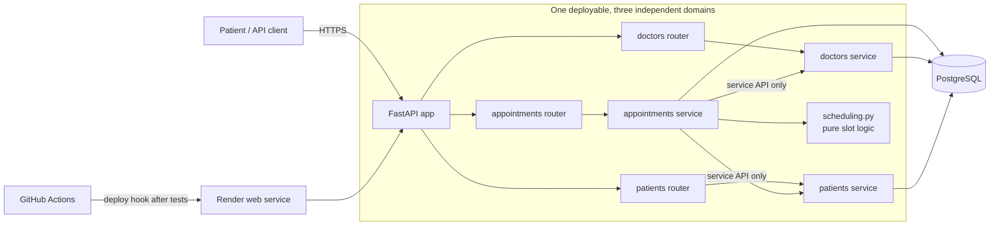
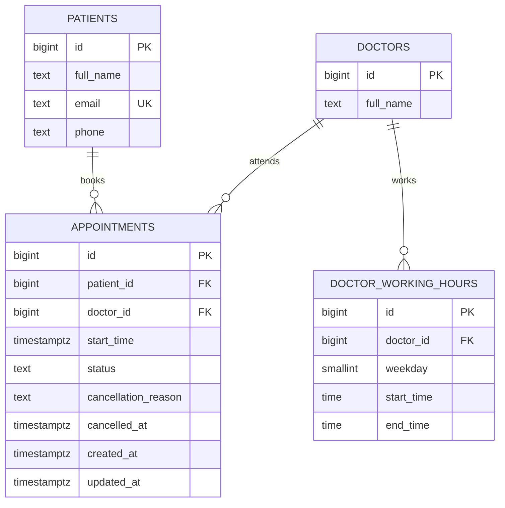
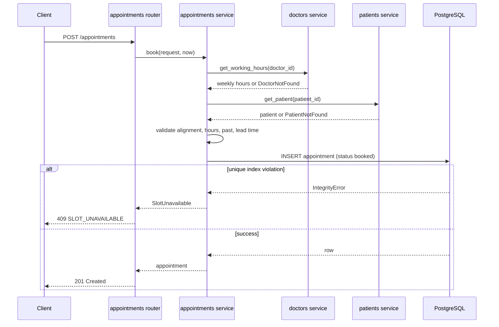

# Clinic Booking System

A REST API for a small clinic (5 doctors, 30-minute slots). Patients see a doctor's free slots for a day, book one, cancel it, or reschedule it. A booked slot is unavailable to everyone else, and the database itself guarantees that, so concurrent requests can never double-book.

Built with **FastAPI**, **SQLAlchemy (async)** and **PostgreSQL**, as a **domain-modular monolith** designed to grow (see [Built to grow](#2-built-to-grow)).

## 1. Submission details

| Item | Value |
|---|---|
| Repository | https://github.com/OmbongiFelix/clinic-booking-system |
| Public URL | https://clinic-booking-system-2jtx.onrender.com |
| Interactive API docs | https://clinic-booking-system-2jtx.onrender.com/docs |
| Health check | https://clinic-booking-system-2jtx.onrender.com/health |
| Deployment branch | `main` |
| Deploy trigger | A merge (push) to `main` runs `cd.yml`: tests, then Render deploy hook, then a `/health` smoke test |
| PR checks | `ci.yml` runs lint and the test suite on every pull request |
| Seeded IDs to try | Doctors `1`-`5`, patients `1`-`3` |

> **Note on cold starts:** if the Render instance and Neon database have been idle, the first request can take a while to respond. Retry after a few seconds, or call `/health` first to wake both.
**Try it in 30 seconds**

```bash
BASE=https://clinic-booking-system-2jtx.onrender.com

# 1. See free slots for doctor 1 (use a future weekday)
curl "$BASE/doctors/1/availability?date=2026-10-27"

# 2. Book one of them
curl -X POST "$BASE/appointments" -H "Content-Type: application/json" \
  -d '{"patient_id":1,"doctor_id":1,"start_time":"2026-10-27T09:00:00+03:00"}'

# 3. Cancel it (use the returned id)
curl -X PATCH "$BASE/appointments/1/cancel" -H "Content-Type: application/json" \
  -d '{"reason":"Patient is travelling"}'
```

---

## 2. Built to grow

The scenario ends with *"We're starting small but want to grow."* That sentence shaped the architecture more than any other.

### The approach: one deployable, independent domains

Today there is one service and one database, which is the right size for 5 doctors. Inside it, the code is split into **three domains**, each a self-contained package:

```
domains/
├── patients/       models · repository · service · router · schemas
├── doctors/        models · repository · service · router · schemas
└── appointments/   models · repository · service · router · schemas · scheduling
```

Three rules keep the domains independent:

1. **Each domain owns its tables, queries, API schemas and routes.** Nothing outside a domain touches its repository or models.
2. **Domains talk to each other only through `service.py`.** `appointments` asks `doctors.service` for working hours and `patients.service` for patient lookups; it never imports their models or repositories.
3. **Dependencies run one way.** `appointments` depends on `doctors` and `patients`. `doctors` and `patients` import nothing from other domains, so there are no cycles.

`api/router.py` only mounts the domain routers. The slot arithmetic lives in `appointments/scheduling.py` as pure functions with no database access, so it can be tested, and reused, on its own.



### Why this design instead of microservices now, or one flat module

| Option | Verdict |
|---|---|
| Flat modules, one big service | Fastest to write, but every future change touches everything and there is no seam to split along |
| Microservices from day one | Network calls, distributed transactions and several deployments for 5 doctors; the booking rule ("a slot is taken or it isn't") would have to survive a network boundary |
| **Domain-modular monolith (chosen)** | One deployment and one transaction for booking today, with the boundaries already in place for tomorrow |

### How each domain can be scaled independently later

Because domains only meet at `service.py`, splitting one out is a contained change rather than a rewrite:

| To do this later | What changes | What does not change |
|---|---|---|
| Extract `doctors` or `patients` into their own service | Replace the in-process call in its `service.py` with an HTTP/gRPC client that has the same function signatures; move its tables to its own database | `appointments` business logic, its router and its tests |
| Scale booking traffic separately | Run more instances of the app, or deploy only the `appointments` router. The app is stateless, and exclusivity is enforced by a database index, so any number of instances stay safe | The booking rules |
| Add notifications (email/SMS) | Write an outbox row in the booking transaction; a worker (for example Taskiq or procrastinate) sends it. A new `notifications` domain subscribes to appointment events | The booking transaction and endpoint contracts |
| Add authentication | A new `accounts` domain issues identities; routers gain a dependency that checks ownership | Domain services and repositories |
| Serve more clinics | Add `clinic_id` to the domain tables and index; doctors become scoped to a clinic | Slot logic in `scheduling.py` |
| Read-heavy availability traffic | Add a cache or a read replica behind `appointments/repository.py` | Router and service contracts |

**An honest caveat:** `appointments` currently has foreign keys to the `doctors` and `patients` tables because they share one database. Extracting either domain into a separate database means replacing that foreign key with a plain ID reference and validating through the service call, which is something the service-only access rule already does today. Nothing here has been load tested; the growth path above is about structure, not measured capacity.

---

## 3. Assignment coverage

| Assignment requirement | Where it is covered |
|---|---|
| **Section 1:** document the system design (models, components, decisions, trade-offs) | [§6 System design](#6-system-design) |
| **Section 2:** FastAPI REST API | [§5 API reference](#5-api-reference) |
| `POST /appointments` validates working hours, not in the past, not taken | [§5.1](#51-post-appointments), [§6.6](#66-booking-rules-and-workflow) |
| `GET /doctors/{id}/availability` lists free 30-minute slots for a date | [§5.2](#52-get-doctorsdoctor_idavailabilitydateyyyy-mm-dd) |
| `PATCH /appointments/{id}/cancel` with reason; slot reusable; error if already cancelled | [§5.3](#53-patch-appointmentsappointment_idcancel) |
| `PATCH /appointments/{id}/reschedule`; old slot freed; new slot validated; error if cancelled | [§5.4](#54-patch-appointmentsappointment_idreschedule) |
| Meaningful errors and correct HTTP status codes | [§5.6 Error model](#56-error-model) |
| Sensible code structure | [§7 Project structure](#7-project-structure) |
| At least basic tests for booking logic | [§8 Testing](#8-testing) |
| **Bonus:** `GET /patients/{id}/appointments`, upcoming, sorted by date | [§5.5](#55-get-patientspatient_idappointments) |
| **Bonus:** prevent bookings within 1 hour of now | Rule A5 in [§6.5](#65-assumptions-and-decisions) |
| **Section 3:** deployed app with a public URL | [§1](#1-submission-details), [§9](#9-deployment-and-cicd) |
| CI runs tests on every pull request | [§9.2](#92-pipeline) |
| Auto-deploy on merge to a designated branch; branch and trigger documented | [§1](#1-submission-details), [§9.2](#92-pipeline) |
| README: URL, deploy branch/trigger, pipeline description, how to run locally | [§1](#1-submission-details), [§4](#4-run-it-locally), [§9](#9-deployment-and-cicd) |
| **Section 4:** AI reflection | [§12](#12-ai-reflection-assignment-section-4) |
| Ambiguities decided and noted | [§6.5](#65-assumptions-and-decisions) |

---

## 4. Run it locally

Prerequisites: Python 3.12+, [`uv`](https://docs.astral.sh/uv/), Docker (for PostgreSQL).

```bash
# 1. Install dependencies
uv sync

# 2. Configure (edit values as needed; see §10)
cp .env.example .env

# 3. Start PostgreSQL
docker compose up -d db

# 4. Create the schema and load seed data (5 doctors, 3 patients)
uv run alembic upgrade head
uv run python -m clinic_booking_system.database.seed

# 5. Run the API (docs at http://localhost:8000/docs)
uv run uvicorn clinic_booking_system.main:app --reload

# 6. Run the tests (needs the local PostgreSQL from step 3)
uv run pytest
```

The seed script is idempotent, so running it twice does not duplicate data. It creates doctors `1`-`5` working Monday to Friday 09:00-17:00 (placeholder hours, see A2) and patients `1`-`3`.

---

## 5. API reference

JSON only. Datetimes are ISO 8601 **with a timezone offset**; dates are `YYYY-MM-DD` in the clinic timezone. The full machine-readable contract is at `/openapi.json` and the interactive version at `/docs`.

| Method and path | Purpose | Success |
|---|---|---|
| `POST /appointments` | Book a slot | `201` |
| `GET /doctors/{doctor_id}/availability?date=YYYY-MM-DD` | List free slots | `200` |
| `PATCH /appointments/{appointment_id}/cancel` | Cancel with a reason | `200` |
| `PATCH /appointments/{appointment_id}/reschedule` | Move to a new slot | `200` |
| `GET /patients/{patient_id}/appointments` | Upcoming appointments, sorted by date (bonus) | `200` |
| `GET /health` | Liveness and database check, used by the deploy smoke test | `200` |

### 5.1 `POST /appointments`

```json
{ "patient_id": 1, "doctor_id": 2, "start_time": "2026-10-27T09:00:00+03:00" }
```

Checks run in this order: request shape (aware datetime, positive IDs) → doctor exists → patient exists → aligned to :00/:30 → weekday has working hours and the slot ends inside them → not in the past → at least 60 minutes from now → insert (the unique index decides "already taken").

Response `201`:

```json
{
  "id": 41, "patient_id": 1, "doctor_id": 2,
  "start_time": "2026-10-27T09:00:00+03:00", "end_time": "2026-10-27T09:30:00+03:00",
  "status": "booked", "cancellation_reason": null, "cancelled_at": null,
  "created_at": "2026-10-19T10:12:03+03:00"
}
```

### 5.2 `GET /doctors/{doctor_id}/availability?date=YYYY-MM-DD`

```json
{
  "doctor_id": 2, "date": "2026-10-27", "timezone": "Africa/Nairobi",
  "slots": [
    { "start_time": "2026-10-27T09:00:00+03:00", "end_time": "2026-10-27T09:30:00+03:00" }
  ]
}
```

How it is computed: take the doctor's working-hours block for that weekday → generate the 30-minute slots that fit → drop slots that the booking rules would reject (past, or inside the 1-hour lead time) → drop start times already held by `booked` appointments (one range query). A non-working day or a past date returns `200` with an empty `slots` list.

### 5.3 `PATCH /appointments/{appointment_id}/cancel`

Body: `{ "reason": "Patient is travelling" }` (required, 1-500 characters). The row is locked, must be `booked` with a future start, and is marked `cancelled` with the reason and timestamp. The slot is bookable again immediately because the exclusivity index only covers `booked` rows. Cancelling twice returns `409 APPOINTMENT_ALREADY_CANCELLED`.

### 5.4 `PATCH /appointments/{appointment_id}/reschedule`

Body: `{ "start_time": "2026-10-28T10:30:00+03:00", "doctor_id": 2 }` (`doctor_id` is optional and defaults to the current doctor). The row is locked, must be `booked` with a future start, and the new slot is validated exactly like a fresh booking. The old slot is freed and the new one taken in one transaction; if the new slot is taken, the request fails with `409` and the original appointment is untouched. Rescheduling a cancelled appointment returns `409 APPOINTMENT_ALREADY_CANCELLED`.

Order of checks: 404 → 409 (cancelled or already started) → 422 (new-slot rules) → 409 (slot taken).

### 5.5 `GET /patients/{patient_id}/appointments`

That patient's `booked` appointments with `start_time >= now`, sorted by `start_time` ascending. Cancelled appointments are excluded. An unknown patient returns `404`.

### 5.6 Error model

Every failure uses one envelope, so clients handle errors in one way:

```json
{ "error": { "code": "SLOT_UNAVAILABLE", "message": "That slot has already been booked.", "details": { "doctor_id": 2, "start_time": "2026-10-27T09:00:00+03:00" } } }
```

| HTTP | Code | When |
|---|---|---|
| 404 | `DOCTOR_NOT_FOUND`, `PATIENT_NOT_FOUND`, `APPOINTMENT_NOT_FOUND` | Unknown identifier |
| 409 | `SLOT_UNAVAILABLE` | Slot already booked (booking or reschedule) |
| 409 | `APPOINTMENT_ALREADY_CANCELLED` | Cancel or reschedule on a cancelled appointment |
| 409 | `APPOINTMENT_ALREADY_STARTED` | Cancel or reschedule after the start time has passed |
| 422 | `REQUEST_VALIDATION` | Malformed body or query, naive datetime, missing or empty `reason` |
| 422 | `SLOT_MISALIGNED` | Not on a :00/:30 boundary |
| 422 | `SLOT_OUTSIDE_WORKING_HOURS` | Non-working weekday, or slot not inside the doctor's hours |
| 422 | `SLOT_IN_PAST` | Start time is earlier than now |
| 422 | `SLOT_TOO_SOON` | Start time is earlier than now + 60 minutes |
| 422 | `SAME_SLOT` | Reschedule to the slot the appointment already holds |
| 500 | `INTERNAL_ERROR` | Unexpected failure: generic message to the client, details logged server-side |

---

## 6. System design

### 6.1 The scenario

> *"We run a small clinic with 5 doctors. Patients need to book appointments online. Each doctor has set working hours and works in 30-minute slots. A patient should see which slots are free for a given doctor on a given day, pick one, and book it. Once booked, that slot must not be available to others. Patients should also be able to cancel. We're starting small but want to grow."*

What the design must guarantee: correctness under concurrent bookings, clear errors, testable time rules, and room to grow ([§2](#2-built-to-grow)).

### 6.2 Models and components

**Models** (one table each, plus working hours):

| Model | Holds |
|---|---|
| `Patient` | Name, unique email, phone |
| `Doctor` | Name |
| `DoctorWorkingHours` | One row per doctor per weekday: start and end time (clinic-local) |
| `Appointment` | Patient, doctor, start time, status (`booked` / `cancelled`), cancellation reason and timestamp |

**Components:**

| Component | Responsibility |
|---|---|
| `domains/patients` | Patient records; `get_patient` |
| `domains/doctors` | Doctors and weekly hours; `get_doctor`, `get_working_hours` |
| `domains/appointments` | Book, cancel, reschedule, availability, upcoming list |
| `appointments/scheduling.py` | Pure functions: generate slots, check alignment, hours, past and lead time. No database access |
| `core/config.py` | Settings from environment variables |
| `core/clock.py` | Injectable "now" so time rules are testable |
| `core/errors.py` | Domain exceptions and their mapping to the error envelope |
| `database/` | Engine, session dependency, model registry, seed script |
| `api/router.py` | Mounts domain routers; no logic |

Flow inside a domain: **router → service → repository → database.** Services raise domain exceptions and never import `HTTPException`; the error handlers translate them.

### 6.3 Data model



| Table | Constraint | Purpose |
|---|---|---|
| `patients` | `UNIQUE (email)` | One record per email |
| `doctor_working_hours` | `UNIQUE (doctor_id, weekday)`, `CHECK (weekday BETWEEN 0 AND 6)` (0 = Monday), `CHECK (start_time < end_time)` | One block per weekday |
| `appointments` | `CHECK (status IN ('booked','cancelled'))` | Valid states only |
| `appointments` | `CHECK (status = 'booked' OR (cancellation_reason IS NOT NULL AND cancelled_at IS NOT NULL))` | A cancelled row always carries a reason |
| `appointments` | **Partial unique index `(doctor_id, start_time) WHERE status = 'booked'`** | **The exclusivity guarantee** |
| `appointments` | Index `(patient_id, start_time)` | Fast upcoming list |

```sql
CREATE UNIQUE INDEX uq_appointments_doctor_start_booked
    ON appointments (doctor_id, start_time)
    WHERE status = 'booked';
```

The real DDL comes from the Alembic migration (`alembic/versions/0001_initial.py`). The 30-minute duration is a constant in code, so no `end_time` is stored.

### 6.4 Key decisions and trade-offs

| Decision | Choice | Why | Alternative considered |
|---|---|---|---|
| Architecture | Domain-modular monolith | Right size now, clean seams for growth ([§2](#2-built-to-grow)) | Microservices (too heavy); flat modules (no growth path) |
| Booking model | Synchronous, single transaction | The assignment needs an immediate, meaningful answer; a queue would defer the outcome and add a broker and worker | Queue and workers: only justified by side effects (notifications) that do not exist yet |
| Exclusivity | Partial unique index in PostgreSQL | The database enforces it atomically, so it holds across instances and under races; cancelling frees the slot by changing `status` | A materialised `slots` table (two sources of truth, a generator job); an exclusion constraint on `tstzrange` (unneeded for a fixed grid) |
| Slots | Computed from working hours minus booked starts | No slot rows to generate or keep in sync | Recomputed per request; trivial at this size |
| Locking | `SELECT ... FOR UPDATE` on cancel and reschedule | Status check and change are consistent; two concurrent cancels give one `200` and one `409` | Optimistic version column |
| Idempotency | The constraint prevents duplicates; a retry returns `409` | No extra storage | `Idempotency-Key` header with stored responses (future) |
| Database driver | `asyncpg` through SQLAlchemy async | Native async driver, widely documented, no pooler in this setup | `psycopg` 3 is equally viable (`postgresql+psycopg://`). Behind a transaction-mode pooler, both need prepared-statement caching turned off. No benchmark was run; the difference is not expected to matter at this scale |
| Layers | ORM models (persistence), Pydantic (API contract), plain value objects in `scheduling.py` | Each layer has one job; ORM objects never cross the API boundary | Using ORM models as request bodies couples the API to the table layout |
| Time | Aware datetimes only, UTC storage, clinic-local working hours, injected clock | Avoids timezone bugs and makes rules testable | Requires `tzdata` and a configured timezone |
| Auth | Out of scope | Not required by the assignment | See [§11](#11-security-limitations-and-future-work) |

### 6.5 Assumptions and decisions

The assignment leaves several points open. Each was decided and is recorded here.

| ID | Ambiguity | Decision |
|---|---|---|
| A1 | Clinic timezone | `Africa/Nairobi`, configurable via `CLINIC_TIMEZONE` |
| A2 | Working hours | Stored per doctor per weekday; seed uses Mon-Fri 09:00-17:00 as placeholders |
| A3 | Slot grid | 30 minutes, aligned to :00 and :30 clinic time; a slot must end at or before the end of working hours |
| A4 | What "already taken" means | An appointment with `status = 'booked'` for the same doctor and start time; cancelled rows never block |
| A5 | "Prevention of bookings within 1 hour of now" (bonus) | Minimum lead time of 60 minutes (`MIN_BOOKING_LEAD_MINUTES`): earlier start times are rejected for booking and for the new slot of a reschedule. Exactly now + 60 minutes is allowed. The upcoming list still shows appointments inside the next hour, since hiding an imminent appointment from its patient would be unhelpful |
| A6 | Availability vs booking rules | Availability applies the same past and lead-time rules, so it never offers a slot that booking would reject |
| A7 | Availability for a past date or non-working day | `200` with an empty list, not an error |
| A8 | Cancel or reschedule after the start time | Rejected with `409 APPOINTMENT_ALREADY_STARTED`, which preserves history |
| A9 | Reschedule to a different doctor | Allowed via optional `doctor_id`; defaults to the current doctor; same validation path |
| A10 | Reschedule to the same slot | `422 SAME_SLOT` |
| A11 | Patient identity | Patients are seeded; `patient_id` is supplied by the client; no login |
| A12 | Booking horizon | None |
| A13 | Date and time format | ISO 8601 with offset; naive datetimes are rejected to prevent silent timezone shifts |

### 6.6 Booking rules and workflow



Reschedule follows the same pattern with a row lock first:


### 6.7 Reliability

- **Double booking:** two simultaneous requests for one slot produce exactly one `201` and one `409`.
- **Crashes:** each operation is one transaction. A crash before commit changes nothing, and the client can safely retry (a retry of a committed booking returns `409`).
- **Database down:** requests fail with a 5xx, and `/health` reports it, so the deploy smoke test catches it.
- **Time rules:** evaluated against an injected clock, so behaviour is deterministic in tests.

---

## 7. Project structure

```
.
├── .github/workflows/
│   ├── ci.yml                 # PR: lint + tests
│   └── cd.yml                 # merge to main: tests, deploy, smoke test
├── alembic/                   # migrations (0001_initial.py)
├── alembic.ini
├── clinic_booking_system/
│   ├── main.py                # FastAPI app and error handlers
│   ├── api/router.py          # mounts domain routers only
│   ├── core/                  # config.py, clock.py, errors.py
│   ├── database/              # db.py, session.py, models_registry.py, seed.py
│   ├── domains/
│   │   ├── patients/          # models, repository, router, schemas, service
│   │   ├── doctors/           # models, repository, router, schemas, service
│   │   └── appointments/      # models, repository, router, schemas, service, scheduling
│   └── tests/
│       ├── conftest.py
│       ├── unit/test_scheduling.py
│       └── integration/test_appointments.py
├── docker-compose.yml         # local PostgreSQL
├── Dockerfile
├── .env.example
├── pyproject.toml
└── uv.lock
```

---

## 8. Testing

| Tier | Scope | Tools |
|---|---|---|
| Unit | `scheduling.py`: slot generation, alignment, working-hours fit, past and lead-time boundaries; no database | `pytest` |
| Integration | Endpoints through `httpx.AsyncClient` against real PostgreSQL | `pytest`, `pytest-asyncio`, `httpx` |

SQLite is deliberately not used: the exclusivity index and row locking depend on PostgreSQL behaviour.

Behaviours covered by the booking logic tests:

- **Booking:** happy path; past start; inside the lead time and exactly at the boundary; outside working hours; non-working weekday; misaligned time; naive datetime; unknown doctor or patient; slot already taken; rebooking after cancellation.
- **Availability:** excludes booked, past and too-soon slots; empty on a non-working day; unknown doctor returns 404.
- **Cancel:** happy path; missing reason; already cancelled; slot bookable again afterwards.
- **Reschedule:** old slot freed and new slot taken; cancelled appointment; new slot taken leaves the original unchanged; same slot.
- **Patient list:** only upcoming booked appointments, sorted ascending.

Run with `uv run pytest` (see [§4](#4-run-it-locally)).

---

## 9. Deployment and CI/CD

### 9.1 Runtime

- **Render web service** running the Docker image with `uvicorn`, and a **Neon PostgreSQL** database (external to Render). The connection string is stored as the `DATABASE_URL` environment variable in the Render service settings.
- **Migrations run at container start** (`alembic upgrade head`), which is acceptable for a single instance. With several instances, move this to a pre-deploy step.
- **No `uv` in production.** `uv` is a build-time tool only. The image builds the app's own virtual environment and puts it on `PATH`, so `alembic` and `uvicorn` are launched directly from that environment instead of through `uv run`.
- **Connection string:** Neon supplies a `postgresql://` URL with libpq options such as `sslmode=require` (and sometimes `channel_binding=require`). The configuration layer rewrites the scheme to `postgresql+asyncpg://` and converts or drops those options, because asyncpg does not accept them as query parameters (TLS is enabled through its `ssl` setting instead).
- **Neon specifics:** Neon computes can suspend when idle, so the first request after a quiet period may be slower.
- Health check on `/health` (`SELECT 1` against the database).

### 9.2 Pipeline

| Workflow | Trigger | What it does |
|---|---|---|
| `ci.yml` | Every `pull_request` | Checks out the code, sets up Python and `uv`, installs from the lockfile (`uv sync --locked`), lints, starts a PostgreSQL service container, runs `pytest` |
| `cd.yml` | Push to **`main`** (that is, a merged PR) | Checks out the code, installs from the lockfile, runs `pytest`, calls the Render deploy hook (`RENDER_DEPLOY_HOOK_URL` secret), then polls `/health` on the public URL as a smoke test |

Supporting settings:

- Branch protection on `main`: a pull request and a passing `ci` check are required before merging.
- Render's own auto-deploy is disabled, so only `cd.yml` deploys and nothing ships untested.
- GitHub secret: `RENDER_DEPLOY_HOOK_URL`. The public URL used by the smoke test is a GitHub variable.

---

## 10. Configuration

| Variable | Example | Notes |
|---|---|---|
| `DATABASE_URL` | `postgresql+asyncpg://<user>:<password>@<host>/<db>` | Secret. Neon connection string, set as an environment variable on Render. A plain `postgresql://` URL with `sslmode=require` is converted automatically |`postgres://` form is converted automatically |
| `CLINIC_TIMEZONE` | `Africa/Nairobi` | IANA name (A1) |
| `MIN_BOOKING_LEAD_MINUTES` | `60` | Booking lead time (A5) |
| `APP_ENV` | `local` / `production` | Controls debug behaviour |
| `LOG_LEVEL` | `INFO` | |

`.env` is never committed; `.env.example` documents the variables.

---

## 11. Security, limitations and future work

**Security**

- Input is validated by Pydantic, and all queries are parameterised through SQLAlchemy.
- Secrets come only from environment variables, GitHub Actions secrets and Render settings.
- Patient personal data (name, email, phone) is kept out of logs; each endpoint returns only what it needs.
- Unexpected errors return a generic 500 envelope without internals.

**Known limitations**

- **No authentication or authorisation.** Anyone who knows an appointment ID can cancel or reschedule it, and `patient_id` is supplied by the client. This is a deliberate, documented scope decision.
- One working block per weekday: no lunch breaks, holidays or doctor time-off.
- Fixed 30-minute duration.
- No notifications; the patient learns the outcome from the API response only.
- A retry of a successful booking returns `409` instead of the original response.
- No performance measurements have been taken, so no performance claims are made.

**Future improvements**

- Authenticated patients with ownership checks (an `accounts` domain).
- `Idempotency-Key` support for booking.
- Notifications through a transactional outbox plus a worker, without changing the booking transaction.
- Doctor time-off and breaks; variable durations with a `tstzrange` exclusion constraint.
- Pagination and filtering on the patient list; rate limiting.
- Splitting a domain into its own service when load or team structure requires it ([§2](#2-built-to-grow)).

---

## 12. AI reflection (assignment Section 4)

AI tools were used throughout, mainly as a reviewer and debugging partner. I made the decisions, ran the code and verified the results myself.

### 1. What did I use AI for across the four sections?

**Section 1: System design**
- Reviewing my design against the assignment text: coverage of every requirement, gaps, contradictions and over-engineering.
- Evaluating and validating choices (modular monolith vs microservices, constraint-based exclusivity vs a slots table, synchronous booking vs a queue) and suggesting improvements.
- Stress-testing edge cases: concurrent bookings, cancel/reschedule races, timezone handling, the meaning of "within 1 hour of now".
- Helping structure the ambiguity register and the error model.

**Section 2: API implementation**
- Debugging database connections and helping choose between `asyncpg` and `psycopg` (connection URL formats, SSL options, prepared-statement behaviour behind poolers).
- Generating the first version of the `seed_db` script (5 doctors with working hours, 3 patients), which I then reviewed and made idempotent.
- Code review of services, repositories and tests, and brainstorming the test case list.

**Section 3: Deployment and CI/CD**
- Help writing and reviewing `cd.yml` (test → deploy hook → health smoke test).
- Debugging production deployment issues, especially getting `alembic` and `uvicorn` to load in production without `uv`, because they were installed in the app's own virtual environment.
- Reviewing the Render configuration, branch protection and secrets handling.

**Section 4 and documentation**
- Drafting and restructuring this README, building the requirement-to-section coverage table, and drawing the Mermaid diagrams, which I then corrected against the actual code.

### 2. One example where AI improved my work

My early design included separate notification and background-worker packages and a task queue, because I was inclined toward Celery. I asked the AI to do a full design review against the assignment text, checking every requirement and flagging anything the assignment did not need. It pointed out that the assignment requires an immediate, meaningful answer to a booking request, and that a queue would defer the outcome and add a broker and worker for side effects that do not exist yet. I removed `notifications/` and `workers/`, made booking a single synchronous transaction, and let a database constraint carry the exclusivity guarantee. The queue stays documented as a future step through a transactional outbox ([§2](#2-built-to-grow)).

### 3. One example where AI output was wrong or incomplete

The AI's deployment guidance assumed commands would be launched through `uv run` (for example `uv run alembic upgrade head` and `uv run uvicorn ...`). In production that failed, because `uv` is not part of the runtime image: I had installed `alembic` and `uvicorn` into the app's own virtual environment. I caught it from the deployment logs, where the container could not start the migration and server commands. The fix was to put the application's virtual environment on `PATH` in the image and call `alembic` and `uvicorn` directly. This is now documented in [§9.1](#91-runtime).

### 4. Two decisions I made without AI, and why I trusted my judgment

- **Domain-level modular design for growth.** I decided the domain boundaries (patients, doctors, appointments) and the service-only access rule myself. I know the codebase I want to be able to split later, and this is a judgment about my own project's direction rather than a factual question.
- **Clinic timezone and working hours.** I chose `Africa/Nairobi` and Monday-Friday 09:00-17:00 as the defaults myself, because I know the local context and the assignment allows making and documenting such decisions.
