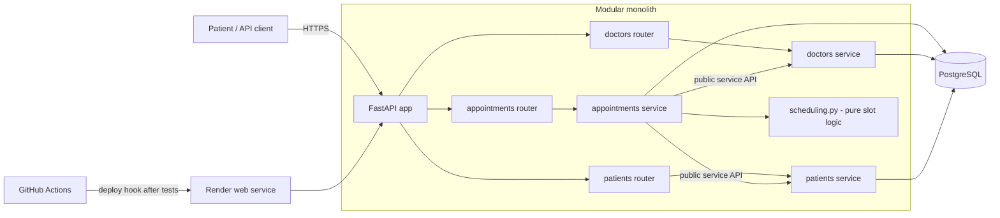
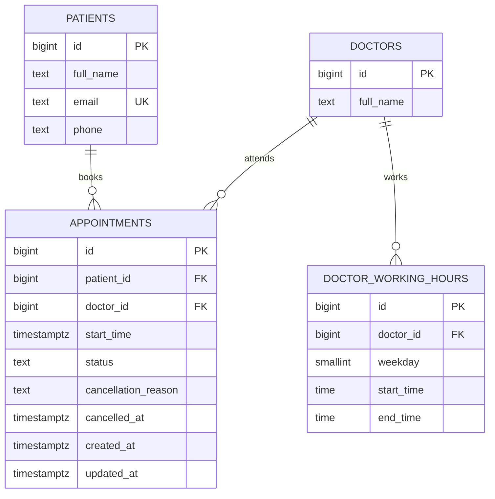
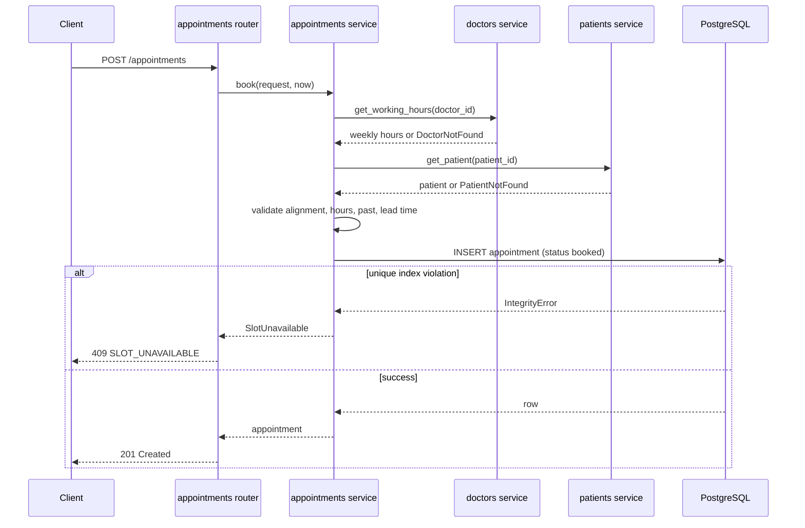
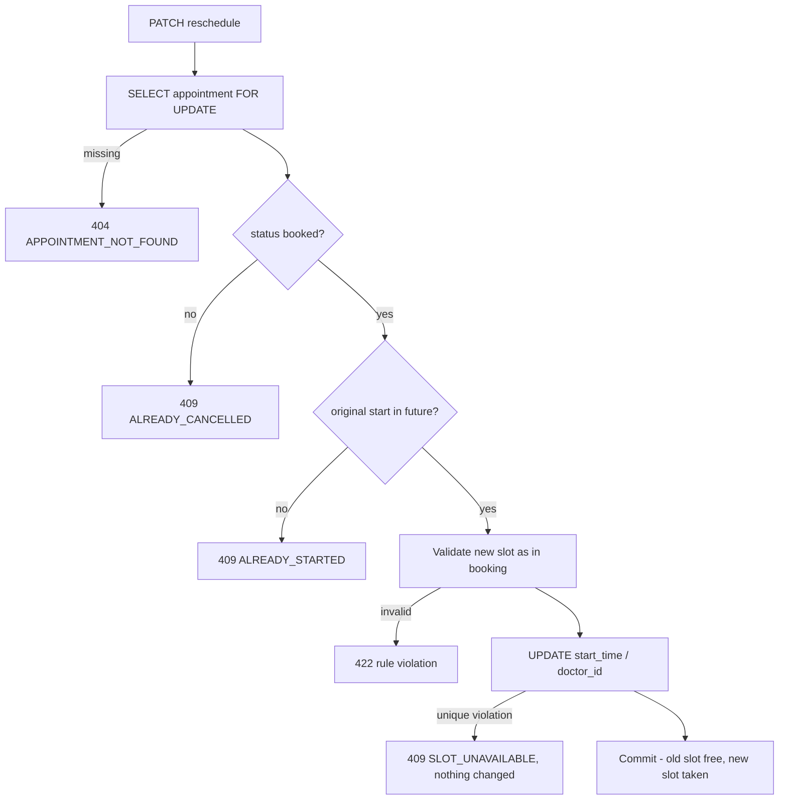

# Clinic Booking System

A REST API that lets patients of a small clinic (5 doctors, 30-minute slots) see free slots, book, cancel and reschedule appointments online. Built with FastAPI, SQLAlchemy (async) and PostgreSQL as a **modular monolith** that can later be split by domain.

**Status legend** (used throughout so the README never claims more than exists)

| Tag | Meaning |
|---|---|
| **[Present]** | Visible in the project tree supplied with the design notes (verify in the repository) |
| **[Designed]** | Decided in this document; not yet implemented |
| **[Proposed]** | Default chosen for an ambiguity or detail; confirm or change |
| **[Planned]** | Future work, deliberately out of the current scope |

> At the time of writing, no endpoint, test, deployment or pipeline run has been verified. Everything marked **[Designed]** must be implemented and checked before submission.

## Submission details

| Item | Value |
|---|---|
| Repository | `<TO BE ADDED: repository URL>` |
| Public URL | `<TO BE ADDED after deployment>` |
| Interactive API docs | `<public URL>/docs` (FastAPI default) **[Designed]** |
| Deployment branch | `main` **[Designed]** |
| Deploy trigger | Merge (push) to `main` runs `cd.yml`: tests, then Render deploy hook, then `/health` smoke test **[Designed]** |
| PR checks | `ci.yml` runs lint and tests on every pull request **[Designed]** |
| Seeded IDs for trying the API | Doctors `1`–`5`, patients `1`–`3` **[Designed]** (see §19) |

---

## 1. Overview

Patients choose a doctor and a date, see the free 30-minute slots, and book one. A booked slot is unavailable to everyone else. Patients can cancel (with a reason) or reschedule. Exclusivity is enforced by the database, not by application logic alone, so concurrent requests cannot double-book a slot.

## 2. Problem statement and motivation

From the assignment: *"We run a small clinic with 5 doctors. Patients need to book appointments online. Each doctor has set working hours and works in 30-minute slots. A patient should see which slots are free for a given doctor on a given day, pick one, and book it. Once booked, that slot must not be available to others. Patients should also be able to cancel. We're starting small but want to grow."*

## 3. Objectives and intended users

- **Patients** (API consumers): view availability, book, cancel, reschedule, list upcoming appointments.
- **Clinic** (stakeholder): no double bookings, predictable behaviour, room to grow.
- **Reviewers**: a deployed API, clear reasoning, tests, and a working pipeline.

Objectives: correctness under concurrent bookings; meaningful errors with correct HTTP status codes; a structure that is easy to test and extend; low operational overhead.

## 4. Assignment requirements and how they are addressed

IDs are used for traceability (this table is the requirement-to-feature map).

| ID | Assignment requirement | Design response | Status |
|---|---|---|---|
| R1 | Document system design in README | §§7–14 | This file |
| R2 | REST API with FastAPI / DRF / Go | FastAPI | **[Present]** dependency, **[Designed]** endpoints |
| R3 | `POST /appointments`: within working hours, not in past, not taken | §13.1, §14.1 | **[Designed]** |
| R4 | `GET /doctors/{id}/availability`: free 30-min slots for a date | §13.2 | **[Designed]** |
| R5 | `PATCH /appointments/{id}/cancel` with reason; slot reusable; error if already cancelled | §13.3 | **[Designed]** |
| R6 | `PATCH /appointments/{id}/reschedule`; old slot freed; new slot validated; error if cancelled | §13.4, §14.2 | **[Designed]** |
| R7 | Bonus: `GET /patients/{id}/appointments` upcoming sorted; no bookings within 1 hour of now | §13.5, rule A5 | **[Designed]** |
| R8 | Meaningful validation errors and correct HTTP statuses | §13.6 | **[Designed]** |
| R9 | Sensible code structure | §7, Appendix A | **[Present]** (to be tidied) |
| R10 | Basic tests for booking logic | §17 | **[Designed]** |
| R11 | Deployed, public URL | §18 | **[Designed]** |
| R12 | CI runs tests on every PR | §18.2 | `ci.yml` **[Present]**, contents to verify |
| R13 | Auto-deploy on merge to designated branch | §18.2 | `cd.yml` **[Present]**, contents to verify |
| R14 | README: URL, deploy branch/trigger, pipeline description, run locally | Submission table, §18, §19 | Fill placeholders |
| R15 | Section 4 AI reflection | §24 | Author must write |
| R16 | Decide ambiguities and note them | §6 | This file |
| R17 | 5 doctors, set working hours, 30-min slots | §11, §19 seed | **[Designed]** |
| R18 | Booked slot unavailable to others | §11, §16 | **[Designed]** |
| R19 | "Starting small but want to grow" | §7, §21 | This file |

## 5. Functional and non-functional requirements

**Functional**
- FR1 List available 30-minute slots for a doctor on a date.
- FR2 Book a slot.
- FR3 Cancel an appointment with a reason; the slot becomes bookable again.
- FR4 Reschedule an appointment to a new slot; the old slot becomes bookable again.
- FR5 List a patient's upcoming appointments, sorted by start time.
- FR6 Reject bookings that start in the past or within 1 hour of now.

**Non-functional**
- NFR1 *Correctness:* no two active appointments for the same doctor and start time, including under concurrent requests.
- NFR2 *Clarity:* every rejected request returns a stable error code, a human-readable message and the right HTTP status.
- NFR3 *Testability:* time-dependent rules testable without waiting; booking logic testable against real PostgreSQL.
- NFR4 *Maintainability:* domain boundaries, no cyclic dependencies, HTTP concerns kept out of business logic.
- NFR5 *Operability:* deploy automatically after tests pass; a `/health` endpoint for smoke checks.
- NFR6 *Performance:* no numeric target is set and none has been measured. At the expected volume (about 80 bookable slots a day if each doctor works 8 hours; the assignment gives no hours) a single instance is expected to be ample.

## 6. Scope, assumptions, constraints, exclusions

### Ambiguity and decision register

| ID | Ambiguity | Decision **[Proposed]** | Rationale |
|---|---|---|---|
| A1 | Clinic timezone not stated | `Africa/Nairobi`, configurable (`CLINIC_TIMEZONE`) | Needed to interpret working hours; change if the clinic is elsewhere |
| A2 | Working hours not stated | Stored per doctor per weekday; seed uses example hours Mon–Fri 09:00–17:00 | Assignment says "set working hours"; values are placeholders |
| A3 | Slot grid | 30 minutes, aligned to :00 and :30 clinic time; a slot must end at or before the working-hours end | Matches the assignment |
| A4 | What "already taken" means | An appointment with `status = 'booked'` for the same doctor and start time | Cancelled rows do not block |
| A5 | "Prevention of bookings within 1 hour of now" (bonus) | Minimum lead time `MIN_BOOKING_LEAD_MINUTES = 60`: a start time earlier than now + 60 minutes is rejected for booking and for the *new* slot of a reschedule. Boundary is inclusive (exactly now + 60 min is allowed). The upcoming-appointments list still shows appointments inside the next hour | The sentence sits under the patient-list endpoint, but a booking rule is the natural reading; hiding an imminent appointment from its patient would be unhelpful |
| A6 | Availability and booking rules | Availability applies the same past and lead-time rules | Avoids offering slots that booking would reject |
| A7 | Availability for a past date or a non-working day | `200` with an empty `slots` list | Not an error condition |
| A8 | Cancelling or rescheduling an appointment whose start time has passed | Rejected with `409 APPOINTMENT_ALREADY_STARTED` | Preserves history; the assignment is silent |
| A9 | Reschedule across doctors | Allowed through an optional `doctor_id`; defaults to the current doctor | Assignment says "a new slot"; the same validation path applies |
| A10 | Reschedule to the same slot | `422 SAME_SLOT` | No-op request is a client error |
| A11 | Patient identity | Patients are seeded; `patient_id` is supplied by the client; no login | Authentication is not in the assignment (see §15) |
| A12 | Booking horizon | None | Not required; may be added later |
| A13 | Date and time format | ISO 8601 with offset for datetimes; `YYYY-MM-DD` for dates (interpreted in clinic timezone); timezone-naive datetimes rejected | Prevents silent timezone shifts |

### Explicit exclusions (current scope)

Authentication and authorisation, notifications (email/SMS), background workers and message queues, payments, doctor time-off and breaks, recurring appointments, admin UI, multi-clinic support. Reasons are in §10 and §21.

## 7. Architecture overview

A **modular monolith**: one FastAPI service, one PostgreSQL database. Code is organised by domain; each domain has router, service, repository, models, schemas. A domain may call another domain only through that domain's `service.py`. Dependencies are one-way:

`appointments` → `doctors`, `patients`. `doctors` and `patients` import nothing from other domains.

Availability is owned by `appointments` (it needs both working hours and booked slots) and mounted at `/doctors/{doctor_id}/availability`.

Request handling is synchronous in outcome: the client receives the booking result in the same response. FastAPI's `async def` endpoints and an async database driver provide concurrency for many simultaneous users; no queue is involved.

## 8. Architecture diagram



## 9. Component responsibilities and interactions

| Component | Responsibility | Depends on |
|---|---|---|
| `domains/patients` | Patient records; `get_patient` | none |
| `domains/doctors` | Doctors and weekly working hours; `get_doctor`, `get_working_hours` | none |
| `domains/appointments` | Book, cancel, reschedule, availability, upcoming list | `doctors.service`, `patients.service` |
| `appointments/scheduling.py` | Pure functions: generate slots for a date, validate a start time against hours, clock and lead time. No database access | none |
| `core/config.py` | Settings from environment | none |
| `core/clock.py` | Injectable "now" (a FastAPI dependency) | none |
| `core/errors.py` | Domain exceptions and their HTTP mapping | none |
| `database/session.py` | Async engine and session dependency | `core/config` |
| `api/router.py` | Includes domain routers; no logic | domain routers |

Interaction rule: routers call services; services call repositories and other domains' services; repositories talk to the database. Services raise domain exceptions and never import `HTTPException`.

## 10. Key design decisions and rationale

| Decision | Choice | Why | Trade-off / alternative considered |
|---|---|---|---|
| Architecture | Modular monolith by domain | Right size for 5 doctors; clean seams for growth | Flat modules: fewer files, weaker growth story |
| Booking model | Synchronous transaction | Assignment requires immediate meaningful errors; a queue defers the outcome and adds a broker and worker | Queue + workers: only justified by side effects or load that do not exist yet |
| Exclusivity | Partial unique index on `(doctor_id, start_time) WHERE status = 'booked'` | The database enforces the invariant atomically; cancelling frees the slot by changing `status` | Materialised `slots` table: explicit rows to lock, but two sources of truth and a generator job; exclusion constraint on `tstzrange`: unnecessary for a fixed grid |
| Slots | Computed from working hours minus booked starts | No slot rows to generate or reconcile | Recomputed per request (trivial at this size) |
| Ghost bookings | A booking is committed in one transaction or not at all | A crash before commit leaves nothing; the client retries | At-least-once queue acknowledgement is needed only if a queue is introduced |
| Idempotency | Constraint guarantees no duplicate booking; a retry returns 409 | Meets the integrity goal with no extra storage | `Idempotency-Key` header with stored responses **[Planned]** |
| Database | PostgreSQL, one shared database | Transactions, partial indexes, `timestamptz` | Database per service only when services are actually split |
| Driver | `asyncpg` via SQLAlchemy async | Already a dependency, widely documented, no pooler in the design | `psycopg` (v3) is equally viable (`postgresql+psycopg://`). The caveat: behind a transaction-mode pooler asyncpg needs `statement_cache_size=0` (or a pooler that supports protocol-level prepared statements, such as recent PgBouncer with `max_prepared_statements`); psycopg also prepares statements by default (`prepare_threshold=5`), so it needs `prepare_threshold=None` in that setup. No benchmark was run; driver latency differences are not expected to matter at this scale |
| Schema layers | ORM models (persistence), Pydantic (API contract), frozen dataclass for pure value objects | Each layer has one job; ORM objects never cross the API boundary | Using ORM models as request bodies couples the API to the table layout |
| Errors | Stable JSON envelope; domain exceptions mapped in handlers | Consistent, testable, keeps HTTP out of services | n/a |
| Time | Aware datetimes only; UTC storage; clinic-local working hours; injected clock | Avoids timezone bugs; testable | Requires `tzdata` and a configured timezone |
| Auth | Out of scope | Not required; avoids hashing/login work | Anyone holding an appointment ID can modify it (see §15) |

## 11. Data model



**Constraints [Designed]**

| Table | Constraint | Purpose |
|---|---|---|
| `patients` | `UNIQUE (email)` | One record per email |
| `doctor_working_hours` | `UNIQUE (doctor_id, weekday)`; `CHECK (weekday BETWEEN 0 AND 6)` (0 = Monday); `CHECK (start_time < end_time)` | One block per weekday (no lunch break in v1) |
| `appointments` | `CHECK (status IN ('booked','cancelled'))` | Valid states |
| `appointments` | `CHECK (status = 'booked' OR (cancellation_reason IS NOT NULL AND cancelled_at IS NOT NULL))` | A cancelled row always has a reason |
| `appointments` | Partial unique index `(doctor_id, start_time) WHERE status = 'booked'` | **The exclusivity guarantee** |
| `appointments` | Index `(patient_id, start_time)` | Patient's upcoming list |

Illustrative SQL (the real DDL is produced by Alembic migrations **[Designed]**):

```sql
CREATE UNIQUE INDEX uq_appointments_doctor_start_booked
    ON appointments (doctor_id, start_time)
    WHERE status = 'booked';
```

Notes: the 30-minute duration is a constant in code (`SLOT_MINUTES = 30`), so no `end_time` is stored; variable durations would add `end_time` and an exclusion constraint **[Planned]**. The slot alignment (:00/:30) and "fits within working hours" rules live in `scheduling.py`, not in the database.

## 12. Database and persistence strategy

- PostgreSQL; SQLAlchemy 2.x async ORM; `asyncpg` driver.
- One session per request (FastAPI dependency); the service commits at the end of a successful operation and rolls back on any exception.
- Migrations with Alembic **[Designed]** (dependency to be added). Seed data (5 doctors with weekly hours, 3 patients) via an idempotent seed script **[Designed]**.
- All datetimes stored as `timestamptz` (UTC). Working hours stored as local `time` and combined with the requested date in the clinic timezone using `zoneinfo`.
- `DATABASE_URL` hosted on Render may use a `postgres://` or `postgresql://` scheme; the configuration layer must convert it to `postgresql+asyncpg://` for SQLAlchemy. Libpq-only query options (for example `sslmode`) may need translating for asyncpg; verify against the hosted database.

## 13. API design

Base path `/`. JSON only. Datetimes are ISO 8601 with offset.

| Method and path | Purpose | Success |
|---|---|---|
| `POST /appointments` | Book a slot (R3) | `201` |
| `GET /doctors/{doctor_id}/availability?date=YYYY-MM-DD` | Free slots (R4) | `200` |
| `PATCH /appointments/{appointment_id}/cancel` | Cancel with reason (R5) | `200` |
| `PATCH /appointments/{appointment_id}/reschedule` | Move to a new slot (R6) | `200` |
| `GET /patients/{patient_id}/appointments` | Upcoming, sorted by date (R7) | `200` |
| `GET /health` | Liveness and database check, for deployment smoke tests (operational, not in the assignment) | `200` |

### 13.1 `POST /appointments`

Request:
```json
{ "patient_id": 1, "doctor_id": 2, "start_time": "2026-10-20T09:00:00+03:00" }
```
Validation order: schema (aware datetime, ids) → doctor exists → patient exists → alignment to :00/:30 → weekday has working hours and slot ends within them → not in the past → at least `MIN_BOOKING_LEAD_MINUTES` ahead → insert (unique index decides "already taken").

Response `201`:
```json
{
  "id": 41, "patient_id": 1, "doctor_id": 2,
  "start_time": "2026-10-20T09:00:00+03:00", "end_time": "2026-10-20T09:30:00+03:00",
  "status": "booked", "created_at": "2026-10-16T10:12:03+03:00"
}
```

### 13.2 `GET /doctors/{doctor_id}/availability?date=2026-10-20`

Response `200`:
```json
{
  "doctor_id": 2, "date": "2026-10-20", "timezone": "Africa/Nairobi",
  "slots": [
    { "start_time": "2026-10-20T09:00:00+03:00", "end_time": "2026-10-20T09:30:00+03:00" }
  ]
}
```
Computation: working-hours block for that weekday → 30-minute slots that fit → remove slots that fail the past/lead-time rules → remove start times held by `booked` appointments (one range query).

### 13.3 `PATCH /appointments/{id}/cancel`

Request: `{ "reason": "Patient is travelling" }` (`reason` required, trimmed, 1–500 characters). Locks the row, requires `status = 'booked'` and a future start; sets `status = 'cancelled'`, `cancellation_reason`, `cancelled_at`. The slot is bookable again immediately because the partial index only covers `booked` rows.

### 13.4 `PATCH /appointments/{id}/reschedule`

Request: `{ "start_time": "2026-10-21T10:30:00+03:00", "doctor_id": 2 }` (`doctor_id` optional). Locks the row; requires `status = 'booked'` and a future original start; validates the new slot exactly as in 13.1; updates `start_time` (and `doctor_id`) in the same transaction. The old slot is freed and the new one taken atomically; a unique violation on the new slot returns 409 and leaves the original appointment unchanged. Order of checks: 404 → 409 (cancelled / already started) → 422 (new slot rules) → 409 (slot taken).

### 13.5 `GET /patients/{patient_id}/appointments`

Returns that patient's `booked` appointments with `start_time >= now`, ordered by `start_time` ascending. Cancelled appointments are excluded. Pagination **[Planned]**.

### 13.6 Error model

```json
{ "error": { "code": "SLOT_UNAVAILABLE", "message": "That slot has already been booked.", "details": { "doctor_id": 2, "start_time": "2026-10-20T09:00:00+03:00" } } }
```

| HTTP | Code | When |
|---|---|---|
| 404 | `DOCTOR_NOT_FOUND`, `PATIENT_NOT_FOUND`, `APPOINTMENT_NOT_FOUND` | Unknown identifier |
| 409 | `SLOT_UNAVAILABLE` | Slot already booked (booking or reschedule) |
| 409 | `APPOINTMENT_ALREADY_CANCELLED` | Cancel or reschedule on a cancelled appointment |
| 409 | `APPOINTMENT_ALREADY_STARTED` | Cancel or reschedule once the start time has passed (A8) |
| 422 | `REQUEST_VALIDATION` | Malformed body or query, naive datetime, missing/empty `reason` (FastAPI validation errors wrapped in the envelope) |
| 422 | `SLOT_MISALIGNED` | Not on a :00/:30 boundary |
| 422 | `SLOT_OUTSIDE_WORKING_HOURS` | Non-working weekday, or slot not inside the doctor's hours |
| 422 | `SLOT_IN_PAST` | Start time earlier than now |
| 422 | `SLOT_TOO_SOON` | Start time earlier than now + lead time (A5) |
| 422 | `SAME_SLOT` | Reschedule to the current slot (A10) |

## 14. Main workflows

### 14.1 Booking



The insert is flushed inside the `try` block so a unique violation is caught where it is translated.

### 14.2 Reschedule



Cancel follows the same pattern: lock, check status and start time, set `status = 'cancelled'`, reason and timestamp, commit.

## 15. Security and privacy considerations

- **Authentication/authorisation: not implemented [Planned].** Anyone who knows an appointment ID can cancel or reschedule it, and `patient_id` is client-supplied. This is a known, documented limitation of this submission. A later version would add authenticated patients and ownership checks.
- Input validation by Pydantic; all queries parameterised through SQLAlchemy.
- Secrets only through environment variables; `.env` must not be committed (`.env.example` only). Deployment secrets live in GitHub Actions and Render settings.
- Personal data held: patient name, email, phone. Keep them out of logs; return only what each endpoint needs.
- Error messages do not expose internals; unexpected exceptions return a generic 500 envelope and are logged server-side.
- CORS is not configured until a browser frontend exists. Rate limiting **[Planned]**.

## 16. Error handling, reliability and failure recovery

- **Double booking:** prevented by the partial unique index. Two simultaneous requests for one slot produce exactly one `201` and one `409`.
- **Cancel/reschedule races:** the appointment row is locked with `SELECT … FOR UPDATE`, so the status check and the change are consistent; two concurrent cancels yield one `200` and one `409`.
- **Partial failure and crashes:** each operation is a single transaction; a crash before commit leaves no change and the client can safely retry (a retry of a committed booking returns 409).
- **Database unavailable:** requests fail with 5xx; `/health` reports the failure so the deployment smoke test catches it.
- **Retries and idempotency:** no idempotency keys in v1 (see §10, §21).
- **Time rules:** evaluated against an injected clock so behaviour is deterministic in tests.

## 17. Testing and verification strategy

Three tiers **[Designed]**; none has been run yet.

| Tier | Scope | Tools |
|---|---|---|
| Unit | `scheduling.py`: slot generation, alignment, working-hours fit, past and lead-time boundaries; no database | `pytest` |
| Integration | Endpoints through `httpx.AsyncClient` against real PostgreSQL (CI service container; `docker compose` locally); clean state per test | `pytest`, `pytest-asyncio`, `httpx` |
| Concurrency | Two simultaneous bookings and two simultaneous cancels | `asyncio.gather` against PostgreSQL |

SQLite is deliberately not used: exclusivity and locking depend on PostgreSQL behaviour.

Minimum case list:

- Booking: happy path; past start; start inside the lead time; exactly at the lead-time boundary; outside working hours; non-working weekday; misaligned time; naive datetime; unknown doctor; unknown patient; slot already taken; rebooking a slot after cancellation.
- Availability: excludes booked slots; excludes past and too-soon slots; empty on non-working day and past date; unknown doctor returns 404; slots end within working hours.
- Cancel: happy path with reason; missing reason; already cancelled; unknown id; slot bookable again afterwards.
- Reschedule: happy path (old slot free, new slot taken); cancelled appointment; new slot taken (original unchanged); new slot violates rules; same slot; optional doctor change.
- Patient list: only upcoming booked appointments; sorted ascending; cancelled excluded; unknown patient returns 404.
- Concurrency: exactly one success among simultaneous bookings for one slot.

## 18. Deployment architecture and configuration

### 18.1 Runtime **[Designed]**

- Render web service running the Docker image (multi-stage, `uv`-based, non-root user) with `uvicorn`.
- Render PostgreSQL, connected via `DATABASE_URL`.
- Migrations run at container start (`alembic upgrade head`), acceptable for a single instance; with several instances use a pre-deploy step instead (availability depends on the Render plan; verify).
- Health check on `/health`.
- **Verify before submission** against Render's current plan terms: idle spin-down and cold starts on free web services, and retention limits on free databases. The app must be reachable when reviewed.

### 18.2 CI/CD **[Designed]** (workflow files **[Present]**, contents to verify)

| Workflow | Trigger | Steps |
|---|---|---|
| `ci.yml` | `pull_request` | Checkout; set up Python and `uv`; `uv sync --locked`; lint; start PostgreSQL service container; `pytest` |
| `cd.yml` | `push` to `main` (a merged PR) | Checkout; `uv sync --locked`; `pytest`; call Render deploy hook (`RENDER_DEPLOY_HOOK_URL` secret); poll `<public URL>/health` as a smoke test |

Supporting settings:
- GitHub branch protection on `main`: require the `ci` check and a pull request before merging.
- Disable Render's own auto-deploy (or use its option to wait for CI checks if available), so only `cd.yml` deploys and nothing ships untested.
- Required GitHub secrets: `RENDER_DEPLOY_HOOK_URL`; a variable for the public URL used by the smoke test.

## 19. Installation and setup

Prerequisites: Python ≥ 3.12, `uv`, Docker (for local PostgreSQL).

```bash
# Dependencies (present in pyproject.toml / uv.lock)
uv sync

# Configuration
cp .env.example .env        # then edit values; see §20

# Local PostgreSQL (assumes a `db` service is defined in docker-compose.yml: verify)
docker compose up -d db

# Database schema and seed data  [Designed: Alembic and seed script to be added]
uv run alembic upgrade head
uv run python -m clinic_booking_system.database.seed

# Run the API (assumes `app` is defined in src/clinic_booking_system/main.py: verify)
uv run uvicorn clinic_booking_system.main:app --reload

# Tests
uv run pytest
```

Packages still to add to `pyproject.toml` **[Designed]**: `alembic`, `pydantic-settings`, `tzdata`, and, for development, `pytest-asyncio`; use `sqlalchemy[asyncio]` if the greenlet dependency is not installed automatically. Also fix `[project.scripts]` (it points to `clinic_booking_system:main`, while the application object lives in `main.py`).

Seed data **[Designed]**: five doctors (IDs 1–5) with Monday–Friday example hours (A2), and three sample patients (IDs 1–3), so the deployed API can be exercised without creating records.

## 20. Environment variables and secrets

Names below are **[Proposed]**; values are placeholders.

| Variable | Example | Notes |
|---|---|---|
| `DATABASE_URL` | `postgresql+asyncpg://<user>:<password>@<host>:5432/<db>` | Secret. Convert Render's `postgres://` / `postgresql://` form (see §12) |
| `CLINIC_TIMEZONE` | `Africa/Nairobi` | IANA name (A1) |
| `MIN_BOOKING_LEAD_MINUTES` | `60` | Booking lead time (A5) |
| `APP_ENV` | `local` / `production` | Controls debug behaviour |
| `LOG_LEVEL` | `INFO` | |

CI/CD secrets (GitHub): `RENDER_DEPLOY_HOOK_URL`. Never commit real credentials; `.env` stays out of version control.

## 21. Known limitations, unresolved decisions, future improvements

**Limitations**
- No authentication (§15).
- No lunch breaks, holidays or doctor time-off; one working block per weekday.
- Fixed 30-minute duration.
- No notifications; a patient learns the outcome from the API response only.
- A retry of a successful booking returns 409 rather than the original response.
- Nothing has been measured; no performance claims are made.

**Unresolved (need author confirmation)**: A1 timezone, A2 real working hours, A8 past-appointment rule, A9 cross-doctor reschedule, A12 booking horizon, Render plan and database retention.

**Future improvements [Planned]**
- Authenticated patients with ownership checks.
- `Idempotency-Key` support for booking.
- Notifications via a transactional outbox table plus a worker (for example procrastinate or Taskiq); the booking transaction stays unchanged.
- Doctor time-off and breaks; variable durations with an exclusion constraint.
- Pagination and filtering on the patient list.
- Splitting a domain into a service if load or team structure requires it; domain boundaries and the service-only access rule are the preparation for that.

## 22. Requirement-to-feature traceability

See the table in §4 (R1–R19). Mapping of requirements to tests will be added once §17 is implemented **[Planned]**.

## 23. Implementation roadmap (3–5 days)

| Day | Milestone |
|---|---|
| 1 | Clean the tree; config, clock, errors; models and Alembic migration; seed script; `/health` |
| 2 | `scheduling.py` with unit tests; availability; booking with unique-index conflict handling |
| 3 | Cancel, reschedule, patient list; integration and concurrency tests |
| 4 | Dockerfile check; `ci.yml`, `cd.yml`; deploy to Render; branch protection; smoke test |
| 5 | Verify the live URL; fill README placeholders; write the AI reflection (§24) |

---

## 24. AI reflection (assignment Section 4)

> **Author to complete.** The assignment asks for an honest account; this scaffold deliberately contains no invented content. Replace each prompt with what actually happened.

1. **What did you use AI for across the four sections?**
   - System design: `<TO BE COMPLETED>`
   - API implementation: `<TO BE COMPLETED>`
   - Deployment and CI/CD: `<TO BE COMPLETED>`
   - README and this reflection: `<TO BE COMPLETED>`
2. **One example where an AI suggestion improved your work, and the prompt you used.**
   `<TO BE COMPLETED: the prompt, the suggestion, and what changed. Candidates from your own process might include a design review prompt, but record only what you actually did.>`
3. **One example where AI output was wrong or incomplete, and how you caught it.**
   `<TO BE COMPLETED: what was wrong, how you noticed (test, documentation, reasoning), what you did.>`
4. **Two decisions you made without AI, and why you trusted your own judgment.**
   - Decision 1: `<TO BE COMPLETED>`
   - Decision 2: `<TO BE COMPLETED>`

---

## Appendix A: Repository layout **[Designed]** (adapted from the supplied tree)

```
.
├── .github/workflows/{ci.yml,cd.yml}
├── alembic/                      # migrations (to add)
├── alembic.ini
├── docker-compose.yml
├── Dockerfile
├── .env.example
├── pyproject.toml
├── README.md
├── src/clinic_booking_system/
│   ├── main.py
│   ├── api/router.py             # mounts domain routers only
│   ├── core/{config.py,clock.py,errors.py}
│   ├── database/{session.py,seed.py}
│   └── domains/
│       ├── patients/{models,repository,router,schemas,service}.py
│       ├── doctors/{models,repository,router,schemas,service}.py
│       └── appointments/{models,repository,router,schemas,service,scheduling}.py
└── tests/
    ├── conftest.py
    ├── unit/
    └── integration/
```

Removed from the supplied tree: `notifications/`, `workers/`, per-package `structure.txt`, duplicate `api/routes.py` and `api/schemas.py` content, and per-domain `tests/` folders (consolidated under `tests/`).
